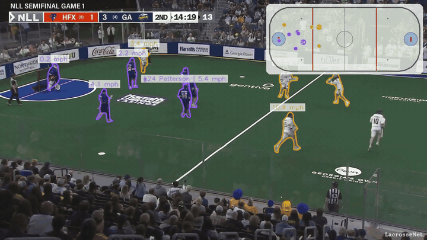
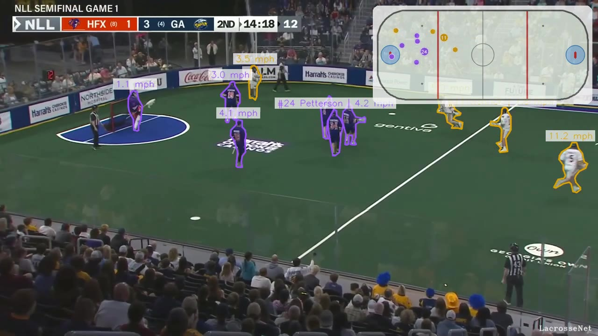
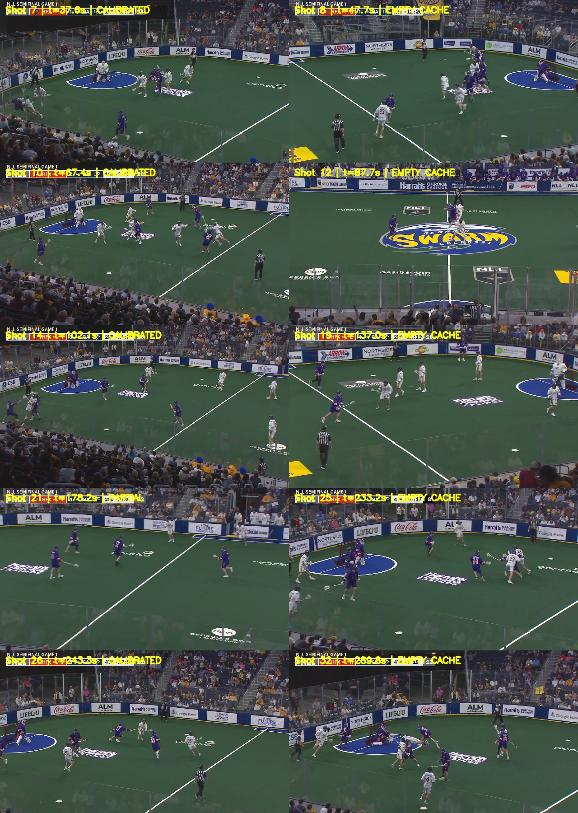
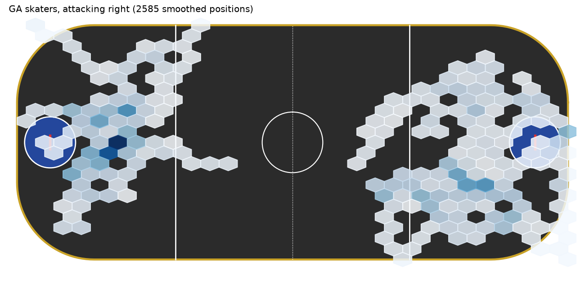
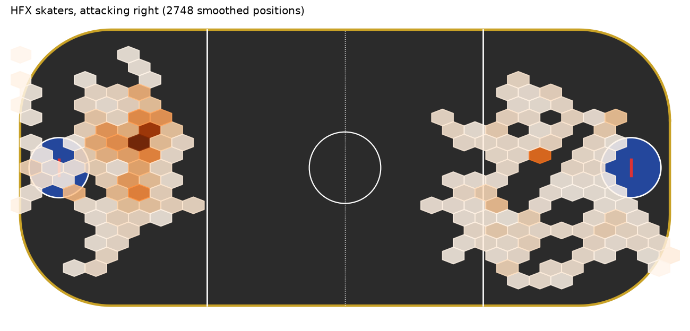
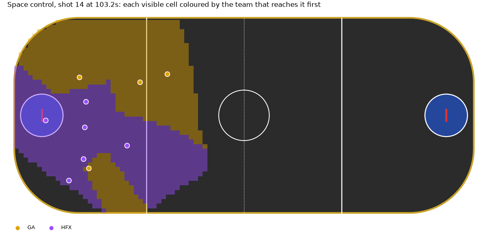
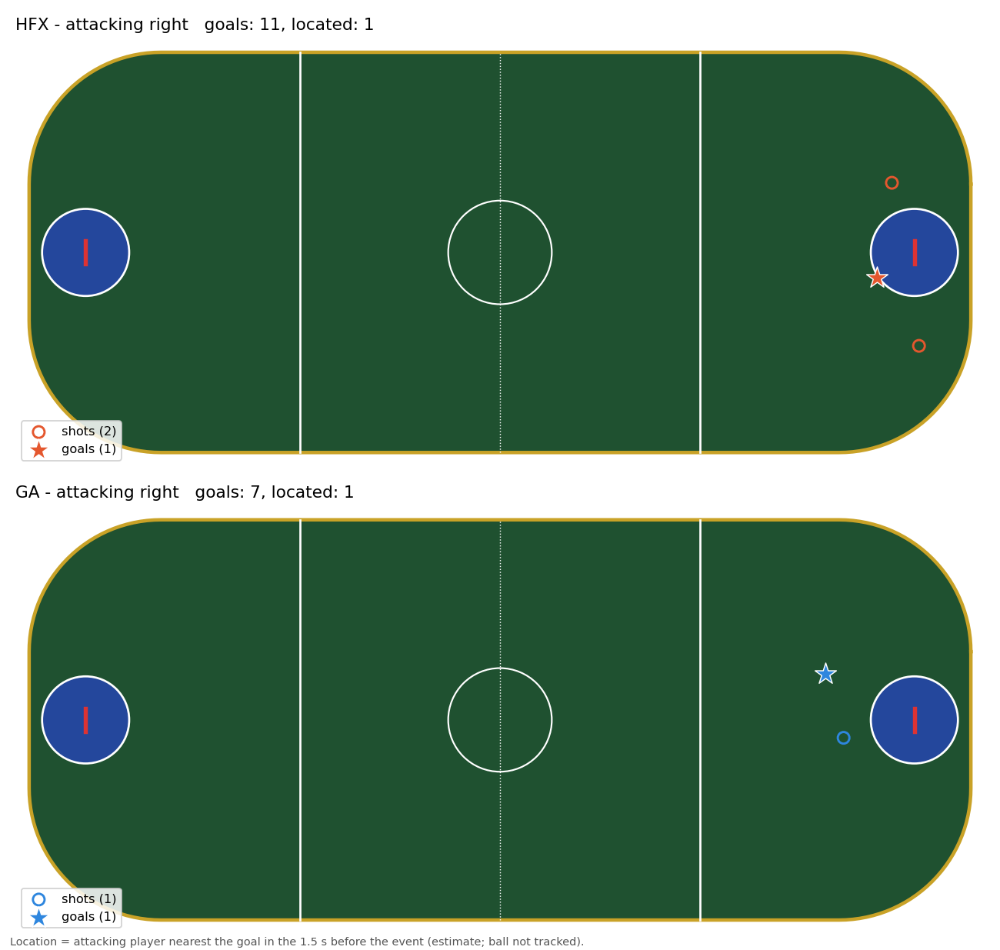
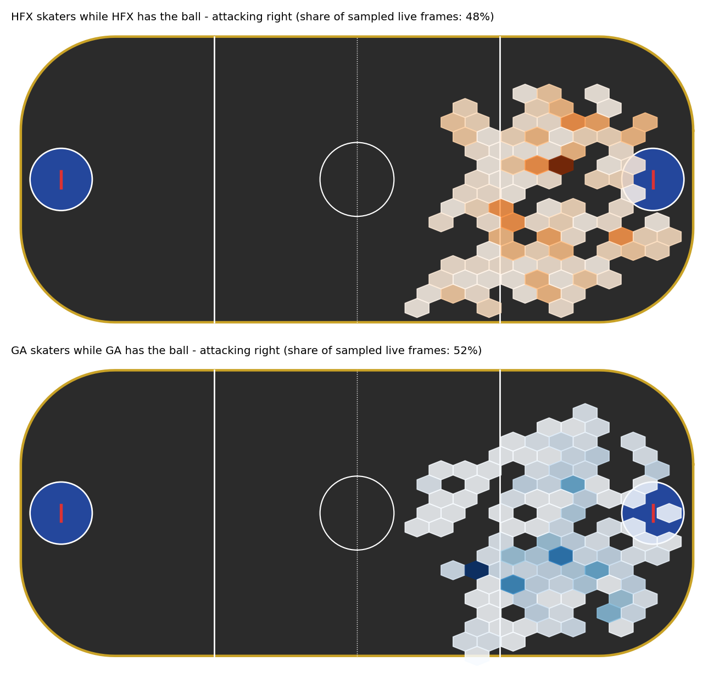
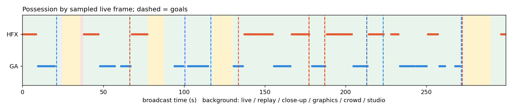

# NLL LacrosseNet

Computer vision for National Lacrosse League (box lacrosse) broadcast video. From an ordinary broadcast,
the two pipelines here find live play, read the scoreboard, and detect goals. They then track every player
and identify them by jersey number, map them onto the floor, and turn that into stats the box score
doesn't have: speed, spacing, defensive gaps, matchups, picks and space control.



| Pipeline | What it does | Main methods |
|---|---|---|
| **`nllcv/`** (broadcast understanding) | splits the broadcast into shots and labels them (live, replay, graphics, crowd, studio); reads score, clock, period and shot clock from the scorebug; detects players and splits teams by jersey colour; registers the floor (homography); detects goals from score changes plus crowd and horn audio; estimates possession and transitions; clips every goal | frame-difference shot cuts, template + glyph OCR with temporal cleaning, YOLOX (ONNX), HSV k-means, PTZ camera model with landmark calibration, audio energy |
| **`laxnet/`** (HockeyNet-style tracking) | segments and tracks each player per live shot; assigns teams; reads jersey numbers and matches them to the roster; puts players on the floor with Kalman smoothing; tracks the ball; finds possessions, passes and shots; computes player-only advanced stats; renders the annotated video | SAM 3 video predictor, SigLIP + UMAP + k-means, Claude vision with track-level voting, constant-velocity Kalman + RTS smoother, SAM 3 / RF-DETR ball detection with camera-motion compensation, rules layer |

`laxnet` builds on `nllcv`: it uses nllcv's live-shot list, scoreboard spine, goal events and floor
homographies.

## Results on the test game

The source is the official highlights of **Halifax Thunderbirds at Georgia Swarm, NLL Semifinal Game 1
(2 May 2026)**: a 5-minute package with 23 live wide-angle shots (245 s of live play). The heavy steps ran
on one A100-80GB on UVA's Rivanna cluster.

**Game state (nllcv)**
- Scorebug read through the whole package. The last score seen is **HFX 11 – GA 7** with 5:11 left in the 4th; the final was 12–7.
- **Goals:** every score change was detected; 10 goals were shown on air and each one is clipped with pre-roll (`results/nllcv_.../clips/`). Where the highlights skip a goal, the score jumps; those are logged as "earlier goal not shown on air".
- **Shots, shot-clock resets and possession changes:** logged in [`events.csv`](results/nllcv_hfx_at_ga_2026-05-02/events.csv).

**Players (laxnet)**
- **235 player tracks** from SAM 3. **70** have a confirmed jersey number (at least 2 agreeing Claude reads, matched to the 2025-26 rosters).
- **Floor coordinates** for 15–19% of track-frames. Only the left-end camera views calibrate; see Limits.
- **Team shape:** GA's skaters were more spread out (mean spacing 29.4 ft vs 25.4 ft) and spent more of their tracked time in the attacking half (53% vs 37%).
- **Defensive gaps:** in their own zone, GA's widest gap between neighbouring defenders averaged 16.9 ft, and that gap was over 12 ft in 71% of frames. HFX averaged 12.0 ft and 33%. HFX defended more compactly, which fits a 12–7 result.
- **Space control:** HFX reached 53% of the visible floor first, and 39% of the 30-ft scoring area against GA's 31%.
- **Speed:** most top speeds were 12–13 mph in short bursts, from smoothed broadcast tracking (roughly ±10–15%).
- **Picks:** 3 found by the heuristic. One example: HFX #15 freed a teammate from GA #4, opening separation from 3.6 ft to 14.8 ft within a second.

**Ball.** SAM 3 without training finds the ball (4–10 px wide) in only about 1% of frames, so possession,
passes and shots from the ball are not meaningful yet. The labelling tool, COCO export and RF-DETR training
job for a proper ball detector are all in this repo (see [docs/laxnet.md](docs/laxnet.md), "Train the ball detector").

## Visuals

| | |
|---|---|
|  Render frame: outlines, "#num Name / mph" tags, radar |  Which views calibrate to the floor |
|  GA skater positions, attacking right |  HFX skater positions, attacking right |
|  Space control, one frame |  Shots and goals with a located shooter (nllcv) |
|  Where each team's skaters were while it had possession (nllcv) |  Possession timeline (nllcv) |

**Videos**
- Annotated renders: [`laxnet_render.mp4`](results/laxnet_hfx_at_ga_2026-05-02/video/laxnet_render.mp4) (4 shots, 41 s) and one file per shot in [`video/`](results/laxnet_hfx_at_ga_2026-05-02/video/).
- Goal clips: all 10 in [`results/nllcv_hfx_at_ga_2026-05-02/clips/`](results/nllcv_hfx_at_ga_2026-05-02/clips/).

**Interactive**
- [`analysis_visuals/player_movement_map.html`](analysis_visuals/player_movement_map.html): player trails on the floor. Download it and open it in a browser.
- [`report.html`](results/nllcv_hfx_at_ga_2026-05-02/report.html): the nllcv game report.

**Tables**

All of these are in `results/laxnet_hfx_at_ga_2026-05-02/`:
- [`player_stats.csv`](results/laxnet_hfx_at_ga_2026-05-02/player_stats.csv), [`team_stats.csv`](results/laxnet_hfx_at_ga_2026-05-02/team_stats.csv)
- `advanced/`: player motion, defensive shape, matchups, picks, space control, stints
- `ball/`: possessions, passes, shots, turnovers
- [`game_report.json`](results/laxnet_hfx_at_ga_2026-05-02/game_report.json): everything above, with definitions, ready for an LLM chat layer

## Repository layout

```
nllcv/             broadcast pipeline (shots, scoreboard, detect, calibrate, homography, audio, events, outputs)
laxnet/            tracking pipeline (prep, track, teams, numbers, floor, ball, plays, advanced, analytics, render)
configs/           nll_2026_broadcast.yaml (nllcv), laxnet.yaml (laxnet)
calibration/       floor landmark references for Gas South Arena
models/            yolox_tiny.onnx (person detector for nllcv)
rosters/           HFX and GA rosters used to name jersey numbers
slurm/             Rivanna jobs: environment setup, full run, partial re-runs, ball labelling and training
analysis_visuals/  interactive movement map
results/           outputs from the test game (above)
docs/              nllcv.md and laxnet.md: stage-by-stage details and settings
```

## Running it

```bash
pip install -r requirements.txt                 # + ffmpeg and tesseract on the system
# put the broadcast in data/ (or let nllcv download it), then:
python -m nllcv run --source data/<broadcast>.mp4 --run runs/nllcv/<game>

# LacrosseNet, CPU stand-ins (YOLOX tracker, colour teams) for development:
python -m laxnet run --run runs/laxnet/<game> --backend cpu --embedder hsv --detector motion
```

On a GPU cluster (UVA Rivanna; SAM 3 needs CUDA ≥ 12.6 and access to the gated `facebook/sam3` weights):

```bash
bash slurm/setup_env.sh                         # conda env: torch, SAM 3, RF-DETR, transformers, umap
conda activate laxnet && hf auth login
echo 'export ANTHROPIC_API_KEY=...' > ~/.laxnet_env && chmod 600 ~/.laxnet_env
mkdir -p logs
sbatch --account=<allocation> slurm/laxnet_gpu.slurm runs/laxnet/<game>
```

Optional: set `ANTHROPIC_WORKSPACE_ID` in `~/.laxnet_env` to send the jersey-number requests to a specific
workspace. [docs/nllcv.md](docs/nllcv.md) and [docs/laxnet.md](docs/laxnet.md) cover every stage, its
outputs and its settings.

## Limits

- **Floor coverage:** the floor registers only for the left-end camera views of this arena. The right-end views don't fit the single fixed-camera model, so floor-based stats come from roughly 15–19% of track-frames.
- **Broadcast view:** the camera shows part of the floor and part of each team. Shape, matchup and space-control stats use the players in view, and each table reports how many were tracked.
- **Jersey numbers:** confirmed only after repeated agreement, so many short or turned-away tracks stay unnamed (70 of 235).
- **Ball:** needs the trained RF-DETR detector before ball-based stats can be trusted.
- **Highlights only:** this run used a highlights package. A full broadcast gives continuous possession and complete events.

## Credits

The broadcast footage, and every frame and clip derived from it, belongs to the National Lacrosse League
and its broadcast partners. It is included only to show the method.

Models and libraries:
- [SAM 3](https://github.com/facebookresearch/sam3) (Meta)
- [SigLIP](https://huggingface.co/google/siglip-base-patch16-224) (Google)
- [YOLOX](https://github.com/Megvii-BaseDetection/YOLOX) (Megvii, Apache-2.0)
- [RF-DETR](https://github.com/roboflow/rf-detr) (Roboflow)
- Claude (Anthropic), for jersey-number reading
- The team-clustering approach follows [roboflow/sports](https://github.com/roboflow/sports), and the overall design follows HockeyNet.
